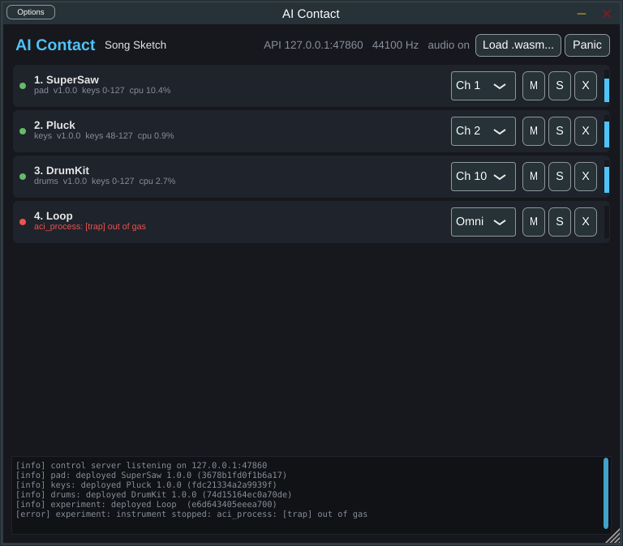
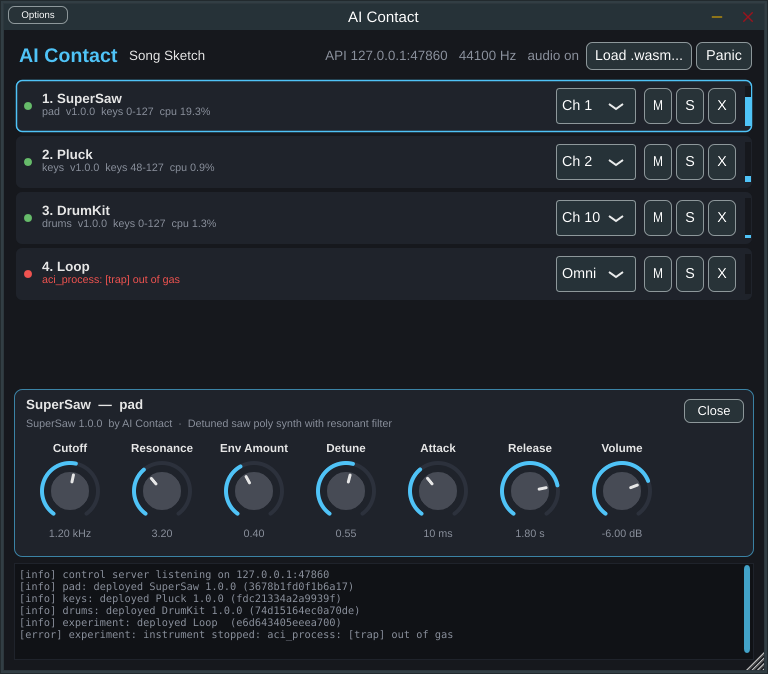
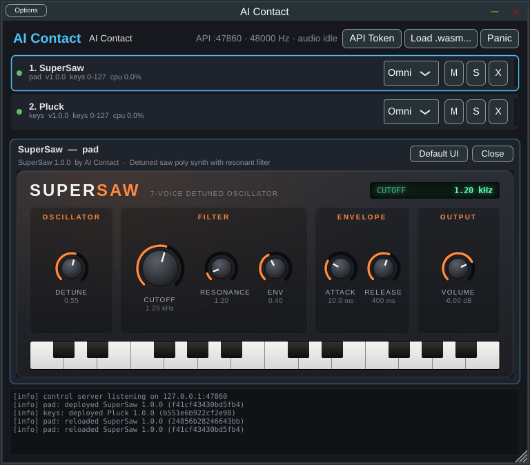
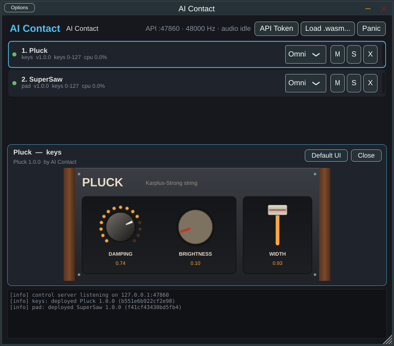
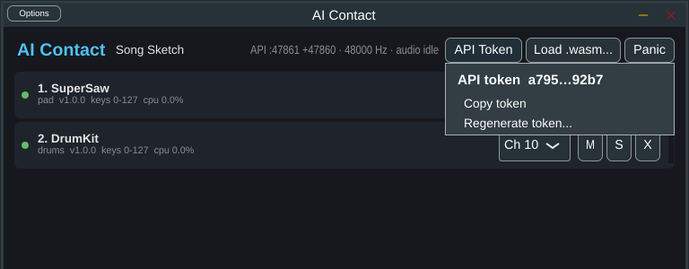

# AI Contact（アイコンタクト）— AI で作った音源をホットリロードできる VST コンテナ

AI なら音源（シンセ）のプログラムを数十秒で書けます。でも、毎回 VST としてビルドし、DAW に登録して、
再スキャンして……というのは使い捨ての速さに見合いません。

**AI Contact** は「音源を入れるための VST」です。DAW に 1 回挿しておけば、あとは
AI（Claude のスキル）がローカルホスト API 経由で音源を **デプロイ・差し替え（ホットリロード）・削除・操作** できます。

## 解説動画


https://github.com/user-attachments/assets/f5acddec-09e8-44d3-af2e-b05972c60c64

**ダウンロード: [最新リリース](https://github.com/masachaco/AiContact/releases/latest)**（Windows / macOS / Linux の Plugin 版・Standalone 版、Claude スキル）

> テストや動作確認は入念には行っていません（macOS / Linux 版は起動も未確認）。自己責任・無保証でお使いください。



*4 スロット稼働中（SuperSaw / Pluck / DrumKit がチャンネル別に発音、わざと無限ループさせた実験音源は停止されて赤表示）*



*スロットをクリックすると、その音源のパネルが開く。メタデータのパラメータ定義（範囲・単位・対数カーブ・段数・ラベル）から自動生成されるので、音源側で UI を書く必要はない。ノブのダブルクリックで既定値に戻る*

```
 ┌───────────── DAW ─────────────┐          ┌──── Claude (skill: aicontact) ────┐
 │  AI Contact (VST3 / AU)       │  HTTP    │  scripts/aicontact.py (CLI)       │
 │  ┌ slot "pad"   ch 1 ─┐       │◀─────────│   build → validate → deploy       │
 │  ├ slot "bass"  ch 2  ├─ mix  │ 127.0.0.1│   note / params / status / logs   │
 │  └ slot "drums" ch 10─┘       │          └───────────────────────────────────┘
 │  1 slot = 1 .aci.wasm file    │
 └───────────────────────────────┘
```

- **1 インスタンスに複数音源**（最大 32 スロット）。各スロットは MIDI チャンネル（または Omni）とキーレンジで入力を選ぶので、1 トラックでドラム・ベース・パッドを同時に鳴らせる
- **ホットリロード**: 同じスロットに新しい版をデプロイすると、パラメータ値を引き継ぎ、押さえている音を鳴らし直し、旧インスタンスは 30ms でクロスフェードアウト。DAW は止まらない
- **安全**: 音源は WebAssembly のサンドボックス内で動き、無限ループは約 20ms で停止、NaN は無音化、クラッシュした音源はそのスロットだけミュート
- **プロジェクトごとの構成**: どのスロットにどの音源ファイル（絶対パス）を入れたか、パラメータ・ルーティング・ミキサーの設定が DAW のプロジェクトに保存され、プロジェクトを開くたびに音源ファイルをその場所から読み込む（DAW がオーディオファイルを参照するのと同じ）。音源ファイルの SHA-256 もプロジェクトに記録し、デプロイ後に**外部から書き換えられたファイルは実行せずにエラー**にする（差し替えたファイルで DAW にコードを送り込まれないように）。ファイルが見つからない・書き換えられた・壊れているスロットは理由を表示して鳴らさず、デプロイし直すか「Locate...」で場所を指定し直すと、その内容を信頼して読み込む
- **音源ごとの操作パネルを自動生成**: パラメータ定義からノブ（対数カーブ・単位表示）や選択肢を作る。API やオートメーションでの変更、ホットリロードにも追従
- **独自 GUI も同梱できる**: HTML/CSS/JS のページや、画像（フィルムストリップのノブ、SVG）を並べたスキンを音源ファイルに埋め込める（下記）
- DAW からのオートメーション: 先頭 16 スロット × 8 パラメータが VST パラメータとして公開される

## 音源フォーマット: ACI (AI Contact Instrument)

**1 音源 = 1 個の WebAssembly ファイル**。仕様は [docs/ACI-SPEC.md](docs/ACI-SPEC.md)。

| 要件 | ACI の答え |
|---|---|
| 単一ファイル | `.wasm` 1 個。メタデータ（名前・パラメータ定義）もサンプルも中に入る |
| 作成が手軽 | 関数 6 個＋メタデータ JSON。C なら `#include "aci.h"` して 1 ファイル（例: [examples/c/sine.c](examples/c/sine.c) は 40 行） |
| 音源向き | ノート・ベロシティ・ピッチベンド・CC・パラメータ（範囲/単位/対数カーブ）・サンプル精度のイベント |
| 標準化 | コンテナは W3C 標準の WebAssembly。ABI は版管理された仕様として固定（VST/CLAP がネイティブ ABI を定めるのと同じ考え方）。仕様書・適合性チェック・検証ツール付き |
| 言語非依存 | C / C++ / Rust / Zig / AssemblyScript / 手書き WAT（[examples/wat/minimal.wat](examples/wat/minimal.wat)） |
| ポータブル | インポートはログ関数 1 個だけ。どのホスト・OS でも同じ音が鳴る |

```c
#include "aci.h"
ACI_META("{\"aci\":1,\"id\":\"me.sine\",\"name\":\"Sine\",\"params\":[...]}")
static float out[ACI_MAX_FRAMES];
int    aci_init(float sr, int max_frames) { ... return 0; }
float* aci_output(int ch)                 { return out; }
void   aci_note_on(int key, float vel)    { ... }
void   aci_note_off(int key, float vel)   { ... }
void   aci_process(int frames)            { ... out[n] = ...; }
```

## 音源ごとのカスタム GUI

自動生成のパネルの代わりに、音源が自前の GUI を持てます。UI のファイルは wasm のカスタムセクションとして
**同じ `.aci.wasm` に埋め込まれる**ので、1 音源 = 1 ファイルのまま扱えます。

| 種類 | 中身 | 表示 |
|---|---|---|
| **HTML UI** | `index.html` + CSS / JS / 画像 | Web ビュー（Windows: WebView2、macOS: WKWebView、Linux: WebKitGTK）。ページには `window.aci`（パラメータの取得・設定・変更通知・試聴）が用意される |
| **スキン** | `ui.json` + PNG / JPEG / SVG | ネイティブ描画。背景画像の上にノブ（フィルムストリップ / 回転画像）・スライダー・スイッチ・ボタン・テキストを配置。コードは動かない |



*HTML UI（[examples/c/supersaw.ui](examples/c/supersaw.ui)）。SVG のノブ、値の表示、試聴用の鍵盤。API やオートメーションでの変更もページに反映される*



*スキン（[examples/c/pluck.ui](examples/c/pluck.ui)）。PNG フィルムストリップのノブ（LED リング）、回転する SVG のノブ、SVG のつまみのスライダー、SVG の背景*

- 音源のソースの隣に `<名前>.ui/` フォルダを置くと、`build` / `deploy` が自動で埋め込む（`--ui DIR` で別フォルダ）
- パネル右上の「Default UI / Custom UI」ボタンで、自動生成パネルといつでも切り替えられる
- UI はネットワークに接続できない（外部 URL・CDN は遮断）。UI に不備があっても音源は動き、既定のパネルが出る
- 仕様は [docs/ACI-SPEC.md §10](docs/ACI-SPEC.md)、書き方は [skill/aicontact/reference/ui.md](skill/aicontact/reference/ui.md)。例: [examples/c/supersaw.ui](examples/c/supersaw.ui)（HTML）、[examples/c/pluck.ui](examples/c/pluck.ui)（スキン）

## 構成

| ディレクトリ | 内容 |
|---|---|
| `docs/ACI-SPEC.md` | ACI v1 フォーマット仕様 |
| `sdk/c/aci.h` | C 用 SDK（ABI 宣言、libm 相当の数学関数、オシレーター・ADSR・フィルタ・ボイスアロケータ） |
| `sdk/web/aci-bridge.js` | HTML UI に注入される `window.aci`（ホストが自動で注入するので音源側で読み込む必要はない） |
| `core/` | ホストエンジン（C++17、JUCE 非依存）: wasm3 による実行、ラック、ロックフリーなスナップショット切替、制御サーバー |
| `plugin/` | JUCE プラグイン（VST3 / AU / Standalone） |
| `host/` | `aicontact-host`: ヘッドレスホスト（DAW 無しで動作確認・検証・WAV 書き出し・API 経由の操作） |
| `skill/aicontact/` | Claude スキル（`SKILL.md`、CLI `scripts/aicontact.py`、書き方ガイド、API リファレンス、同梱 SDK） |
| `examples/` | サンプル音源（Sine, SuperSaw, DrumKit, Pluck, WAT Square） |
| `tests/` | CLI エンドツーエンドテスト、VST3 ホスティングテスト |

## ダウンロード（Windows / macOS / Linux）

ビルド済みのものは GitHub から入手できます。

- **リリース版**: [Releases](https://github.com/masachaco/AiContact/releases/latest) から、OS ごとの Plugin 版・Standalone 版とスキルの zip をダウンロードできます（ログイン不要）。`v0.1.0` のようなタグを打つと自動で公開されます
- **最新のビルド**: Actions の各実行ページのArtifacts。DAWで使う場合は `AIContact-Windows-Plugin`、単体アプリとヘッドレスホストが必要な場合は `AIContact-Windows-Standalone` を選びます

### ビルド成果物（main の最新ビルド）

| OS | DAW 用（Plugin） | 単体アプリ（Standalone ＋ `aicontact-host`） |
|---|---|---|
| Windows | [AIContact-Windows-Plugin](https://github.com/masachaco/AiContact/actions/runs/38110949117/artifacts/11690649104)（VST3） | [AIContact-Windows-Standalone](https://github.com/masachaco/AiContact/actions/runs/38110949117/artifacts/11690639261) |
| macOS | [AIContact-macOS-Plugin](https://github.com/masachaco/AiContact/actions/runs/38110949117/artifacts/11692065648)（VST3 / AU） | [AIContact-macOS-Standalone](https://github.com/masachaco/AiContact/actions/runs/38110949117/artifacts/11691885808) |
| Linux | [AIContact-Linux-Plugin](https://github.com/masachaco/AiContact/actions/runs/38110949117/artifacts/11692235310)（VST3） | [AIContact-Linux-Standalone](https://github.com/masachaco/AiContact/actions/runs/38110949117/artifacts/11691795986) |

- [このビルドの実行ページ](https://github.com/masachaco/AiContact/actions/runs/38110949117)（全ジョブ成功）。Actions の成果物は、ダウンロードに **GitHub へのログインが必要**で、
  保存期間（90 日）を過ぎると消えます。ログイン不要でずっと置いておけるのはリリース版です
- スキルはこの中に含まれていません。リポジトリの `skill/` からインストールしてください（下記）

WindowsのPlugin版にはVST3とライセンスだけを収録し、Chromeが警告しやすい `.exe` は含めていません。
Standalone版の実行ファイルは現在コード署名されていないため、ChromeやWindows SmartScreenが
「一般的にダウンロードされていないファイル」として警告する場合があります。

> **動作確認について**: 作者の手元には Windows 環境しかないため、macOS 版・Linux 版のバイナリは動作確認していません
> （CI でビルドと VST3 の読み込みテストを通しているだけです）。どの OS 版も無保証で、自己責任でお使いください。

Windows でのインストール:
1. `AI Contact.vst3` を `C:\Program Files\Common Files\VST3` にコピーし、DAW でプラグインを再スキャン
2. スキル: リポジトリの `skill\install.ps1` を実行（`%USERPROFILE%\.claude\skills\aicontact` に入ります）
3. C で音源を書くなら [LLVM](https://releases.llvm.org/) をインストール（clang と wasm-ld が入ります）

## ビルド

必要なもの: CMake 3.22+、C++17 コンパイラ。JUCE / wasm3 / nlohmann_json は自動で取得されます。
HTML UI 対応には、Linux では `libwebkit2gtk-4.1-dev libgtk-3-dev`、Windows では NuGet の `Microsoft.Web.WebView2`
パッケージ（`-DJUCE_WEBVIEW2_PACKAGE_LOCATION=...`、取得方法は `.github/workflows/build.yml`）が必要です。見つからなければ
HTML UI 無しでビルドされます（スキンと自動生成パネルは使える）。

```sh
cmake -S . -B build -DCMAKE_BUILD_TYPE=Release
cmake --build build --config Release -j
```

成果物:
- `build/plugin/AIContact_artefacts/Release/VST3/AI Contact.vst3` → VST3 フォルダへコピー
  (Windows: `C:\Program Files\Common Files\VST3`, macOS: `~/Library/Audio/Plug-Ins/VST3`)
- `build/plugin/AIContact_artefacts/Release/Standalone/` → DAW 無しで使えるスタンドアロン版
- `build/aicontact-host`

GitHub Actions（`.github/workflows/build.yml`）は push ごとに、Windows / macOS / Linux でプラグインをビルドし VST3 として読み込むテストを行い、
Linux と Windows でヘッドレスホストとスキル CLI のエンドツーエンドテストを実行します。

## Claude スキルのセットアップ

```sh
skill/install.sh            # ~/.claude/skills/aicontact にコピー（--link でシンボリックリンク）
# Windows: powershell -File skill\install.ps1
```

CLI は Python 標準ライブラリだけで動きます（pip 不要）。C で音源を書くには wasm32 ターゲット付きの clang が必要です
（Windows: [LLVM](https://releases.llvm.org/)、macOS: `brew install llvm`、Linux: `clang` と `lld`）。

最初に、プラグイン画面の **「API Token」→「Copy token」** でトークンをコピーして Claude に渡してください
（CLI は環境変数 `AICONTACT_TOKEN` で受け取ります）。あとは Claude に「アシッドベースを作って ch2 に入れて」と頼むだけです。
スキルが `aicontact.py deploy acid.c --slot bass --channel 2` のように CLI を使います。音源はソースの隣に
`acid.aci.wasm` としてビルドされ、プロジェクトはそのファイルを参照するので、消したり動かしたりしないでください。

| CLI コマンド | 内容 |
|---|---|
| `deploy FILE [--slot ID] [--channel N] ...` | C/WAT/wasm → ビルド → 検証 → デプロイ。既存スロット ID ならホットリロード |
| `validate FILE [--wav out.wav]` | デプロイせずに検証（試奏レンダリング、NaN・無音・クリップ・DC・鳴りっぱなし検出、プラグインと同じエンジンでの CPU 負荷、全パラメータ min/max 掃引） |
| `note C4 E4 G4 --slot pad` | DAW 上で試聴 |
| `params pad Cutoff=800` / `update pad --channel 3 --mute` | パラメータ / ルーティング・ミキサー |
| `status` / `logs` / `export` / `remove` / `clear` / `panic` | 状態・ログ・書き出し・削除 |
| `ui preview FILE --screenshot ui.png` / `ui list` / `ui extract` / `ui pack` | カスタム GUI の確認（パラメータを模擬してブラウザで描画）・取り出し・差し替え |

API は素の HTTP/JSON なので curl やほかのツールからも叩けます（[skill/aicontact/reference/api.md](skill/aicontact/reference/api.md)）。

```sh
curl -s -H "Authorization: Bearer $AICONTACT_TOKEN" localhost:47860/rpc -d '{"method":"slot.note","params":{"slot_id":"pad","keys":["C4","E4","G4"]}}'
```

## 仕組み

- **制御**: 各 AI Contact インスタンス（ラック）は `127.0.0.1` 上の自分のポート（47861〜）で小さな HTTP/JSON API を開きます。最初に起動したラックはさらに **47860 番でラック一覧の窓口**を兼ね、ほかのラックはそこに自分を登録します。CLI は 47860 にだけ問い合わせ、一覧（`racks.list`）の取得も各ラックへの操作も窓口経由で行います（ラック名かポートで指定）。窓口のラックを閉じると、残りのラックが数秒で窓口を引き継ぎます。設定ファイルや一覧ファイルは使いません。ブラウザからのリクエスト（Origin ヘッダ付き）は拒否します
- **認証**: API は自動生成されるトークン（256 ビット）が無いと一切受け付けません。トークンはアプリの設定として保持され（全インスタンス共通）、同じ PC のほかのユーザーやプログラムが勝手に音源を入れたり、ファイルを読ませたりすることはできません
  - プラグイン画面の **「API Token」ボタン**から、トークンのコピーと再生成（古いトークンは即無効）ができる。コピーしたトークンを Claude に渡すか（環境変数 `AICONTACT_TOKEN`）、curl などに貼って使う
  - ヘッドレスの `aicontact-host serve` は起動時にトークンを生成して表示する（`--token` で指定も可）
  - Claude が WSL、DAW が Windows のように**別マシンのラック**を操作する場合も、窓口の 47860 番だけ届けばよい。WSL を `networkingMode=mirrored` にすればそのまま届く。NAT モードのままなら Windows 側で `netsh interface portproxy` により 47860 番を `127.0.0.1` へ転送してファイアウォールで許可し、WSL 側で `AICONTACT_ADDR=<Windows の IP>`（`ip route | awk '/^default/{print $3}'`）を設定する。音源ファイルは WSL 内に置いたままでよい（CLI が `\\wsl.localhost\...` 形式のパスに変換して渡す）

  
- **リアルタイム安全性**: 音源のロード・コンパイル・初期化は制御スレッドで行い、完成した「ラックのスナップショット」をアトミックに差し替えます。オーディオスレッドはロックもメモリ確保もしません。古いスナップショットはエポックカウンタでオーディオスレッドが使い終えたことを確認してから解放します
- **実行**: wasm3（インタプリタ）。JIT が使えない環境（iOS 等）にも移植でき、ガス（実行量）計測で暴走を止められます
- **ブロック処理**: 音源は 256 サンプル単位で呼ばれ、MIDI イベント位置でブロックを分割するのでサンプル精度

## レイテンシと CPU 負荷

**レイテンシ（遅延）はネイティブと同じで、追加はゼロです。** AI Contact は DAW から渡されたバッファの中で、
その場で音源を呼んで書き込みます。先読みや追加のバッファリングはしません。MIDI イベントの位置でブロックを分割するので、
発音タイミングもサンプル単位で正確です。

違いが出るのは **CPU 効率（スループット）** です。同じ SuperSaw のソース（8 ボイス、48kHz、256 サンプルブロック）で計測しました:

| 実行方式 | 1 ブロックの処理時間 | 1 コアに対する負荷 | ネイティブ比 |
|---|---|---|---|
| ネイティブ (clang -O2) | 0.22 ms | 4.1 % | 1× |
| wasmtime (JIT) | 0.26 ms | 4.9 % | 1.2× |
| **wasm3（AI Contact の現エンジン、インタプリタ）** | 0.98 ms | 18 % | 約 4.5× |

締め切り（256 サンプル = 5.3 ms）に対して十分間に合っているので、音切れも遅延もありません。
重い音源を何十個も同時に鳴らす場合は、JIT エンジン（wasmtime 等）に差し替えればほぼネイティブ並みになります
（`InstrumentInstance` の内部だけの変更で、フォーマットは変わりません）。

## 動作確認（DAW 無し）

```sh
build/aicontact-host check examples/prebuilt/sine.aci.wasm     # 適合性チェック
build/aicontact-host validate examples/prebuilt/supersaw.aci.wasm  # 試奏レンダリング＋解析
build/aicontact-host render my.wasm -o out.wav --notes 60,64,67
build/aicontact-host serve --name "Test Rack"                # API で操作できるヘッドレスラック
python3 tests/test_cli_e2e.py build/aicontact-host           # E2E テスト
```

## ライセンス

- **このリポジトリのコード**（エンジン、プラグインのソース、ヘッドレスホスト、Claude スキル、ドキュメント）: [MIT License](LICENSE)
- **音源 SDK と作例**（`sdk/`、スキル同梱の `skill/aicontact/sdk/`、`examples/`）: [MIT-0](sdk/LICENSE)。
  `aci.h` のコードは作った音源の中に組み込まれるので、表示義務も無いライセンスにしています。作った音源は自由なライセンスで配布できます
- **配布するプラグインのバイナリ**（VST3 / AU / Standalone）: JUCE（AGPLv3）と VST3 SDK（GPLv3）を含むため、AGPLv3 の条件で配布します。
  使用しているライブラリの一覧と著作権表示は [THIRD_PARTY_NOTICES.md](THIRD_PARTY_NOTICES.md) を参照

いずれも**無保証**です。作者は、このソフトウェアやこれで作った音源の利用によって生じたいかなる損害についても責任を負いません。
